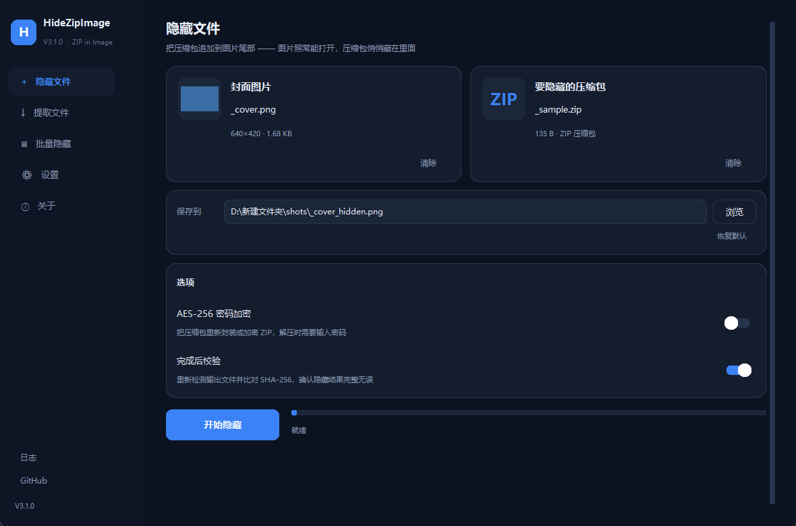

# HideZipImage · 把压缩包藏进图片里

[](https://github.com/xinyuwang668-arch/Hide-Zip2Image/releases)
[](https://www.python.org/)
[](LICENSE)

把 ZIP / RAR / 7Z 压缩包追加到图片文件末尾：**图片照常能打开、能预览、能发出去**，压缩包悄悄藏在后面；需要时再用本程序把它完整取出来。



---

## 一、软件说明

本软件为个人开发的开源软件，主要用于将压缩包类文件（RAR、7Z、ZIP）隐藏至图片类文件（JPG、PNG、WEBP、BMP）中。

本软件仅提供相关文件处理功能，用户应当自行确认所处理文件的合法性、安全性以及使用目的。

## 二、免责声明

本软件由个人开发者独立制作与维护。

由于用户使用本软件所产生的任何直接或间接损失，包括但不限于**财产损失、数据丢失、文件损坏、设备损坏以及其他精神或非财产性损失**，软件作者在法律允许的范围内不承担责任。

若因用户自身操作不当、违规使用、第三方软件或服务、网络环境、设备故障以及其他非软件作者可控制因素所造成的损失，由相应过失方承担相应责任。

用户在使用本软件前，应自行做好重要文件的备份，并自行承担使用本软件所产生的相关风险。

> **这不是加密工具。** 文件末尾多出来的数据，对了解格式的人来说是可见的。
> 需要真正保密，请勾选「AES-256 密码加密」，或配合专门的加密软件使用。

## 三、功能说明

支持的压缩包格式：

* ZIP（含 AES-256 加密 ZIP）
* RAR
* 7Z

支持的图片格式：

* JPG / JPEG
* PNG
* WEBP
* BMP

### V3.1.0 的四个页面

| 页面 | 作用 |
| --- | --- |
| **隐藏文件** | 一张图片 + 一个压缩包 → 一张新的隐藏图，可选 AES-256 加密、完成后 SHA-256 校验 |
| **提取文件** | 选中隐藏图后自动检测尾部结构，显示类型 / 大小 / 起始偏移 / 结构校验，再一键取出 |
| **批量隐藏** | 一张封面图，依次藏入多个压缩包，各自生成一张隐藏图，逐条显示成功 / 失败 |
| **设置** | 主题色、明暗模式、是否自动打开文件夹、是否覆盖同名文件、是否校验、日志…… |

其他细节：

* 支持把文件**直接拖进窗口**（卡片内、页面空白处都可以）。
* 写入采用 `.part` 临时文件 + 原子替换：**中途取消或失败不会留下半个坏文件**。
* 隐藏完成后可自动重新检测偏移并比对 SHA-256，确认藏进去的东西确实完整。
* 检测只读取文件尾部固定大小，**几 GB 的图片也不会整份读进内存**。
* 输出路径与源文件相同、扩展名不匹配等误操作会被拦下。

## 四、"关于"页面

"关于"页面用于显示软件版本、软件作者、软件功能、使用提示及相关说明。

## 五、"检查更新"功能

当软件检测到有新版本时，用户确认后软件会跳转至 GitHub 页面，用户可以从相关页面获取最新版本。

由于网络环境及地区网络限制等原因，部分地区用户可能无法正常访问 GitHub。

**中国大陆地区用户如无法正常访问 GitHub，可能需要使用能够正常访问 GitHub 的网络环境后再进行更新。**

软件作者不会通过本软件强制用户更新版本。

## 六、问题反馈

如果您在使用过程中发现软件存在 **Bug、异常行为、滥用、盗取、欺诈或其他问题**，请及时联系软件作者。

**联系方式：** [xinyuwang668@gmail.com](mailto:xinyuwang668@gmail.com)

反馈问题时，如果条件允许，请提供问题描述、操作步骤及相关截图或错误信息，以便作者进行排查。

## 七、开源说明

本软件为开源项目，源码公开在本仓库中：

```
hide_zip_image_v310.py    # V3.1.0 新界面入口（推荐）
hzi/core.py               # 无界面核心：检测 / 隐藏 / 提取 / 批量 / 设置 / 日志
hzi/ui.py                 # customtkinter 界面（侧边栏 + 卡片）
hzi/theme.py              # 主题色与明暗配色
hide_zip_image_v293.py    # V2.9.3 旧版单文件，保留作参考
tools/                    # 自测脚本（core 单测 + 界面冒烟 + 端到端流程）
```

### 运行

```bash
pip install customtkinter tkinterdnd2 pyzipper pillow
python hide_zip_image_v310.py
```

### 打包

```bash
pyinstaller HideZipImage_V3.1.0.spec
```

打包配置见 `HideZipImage_V3.1.0.spec`，安装包脚本见 `installer.iss`。

### 自测

```bash
python tools/test_core.py      # 核心逻辑，52 项
python tools/test_ui_flow.py   # 界面端到端流程
```

## 八、致谢

感谢 [customtkinter](https://github.com/TomSchimansky/CustomTkinter)、[tkinterdnd2](https://github.com/pmgagne/tkinterdnd2)、[pyzipper](https://github.com/danifus/pyzipper) 等开源项目。
